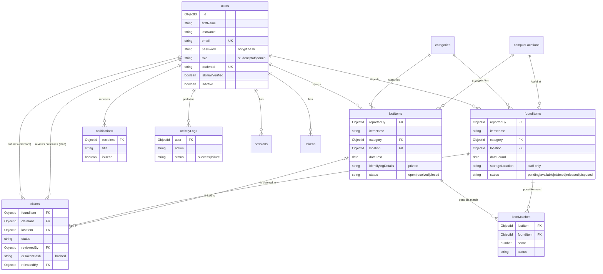

# Web-Based Secured Student Lost and Found System

A MERN-stack (MongoDB, Express, React, Node.js) system where students report lost and found items, get notified about possible matches, and claim items through a staff-verified process with one-time QR codes.

---

## 1. Features

| Role | What they can do |
|---|---|
| **Student** | Register (email verification required), log in, report lost and found items with photos, search and filter items, see possible matches, submit claims with proof, answer staff questions, get a QR code when approved, track claims, receive real-time and email notifications, manage profile and password |
| **Staff** | Receive turned-in items, record found items, manage item status and storage location, review claims (request info, approve, reject), verify QR codes and release items, view release records and item/claim activity logs |
| **Admin** | Everything staff can do, plus: manage students, create staff and admin accounts, activate or deactivate accounts, unlock accounts, manage categories and campus locations, view the dashboard with charts and security alerts, reports and CSV export, full activity logs, system settings, announcements |

---

## 2. Folder structure

```text
student-lost-found-system/
├── client/                    React + Vite frontend
│   ├── src/
│   │   ├── components/        Reusable UI pieces (cards, modals, filters)
│   │   ├── context/           Login state, toasts, real-time notifications
│   │   ├── hooks/             useAuth, useToast, useLookups...
│   │   ├── layouts/           PublicLayout, DashboardLayout (sidebar per role)
│   │   ├── pages/             public/ auth/ student/ staff/ admin/ shared/
│   │   ├── services/api.js    Axios setup (CSRF token + automatic session refresh)
│   │   └── utils/             Formatting, status labels, chart setup
│   └── vite.config.js         Proxy: /api -> http://localhost:5000
│
├── server/                    Node.js + Express backend
│   ├── config/                env.js (settings), db.js (MongoDB connection)
│   ├── controllers/           The logic for each feature
│   ├── middleware/            auth (RBAC), CSRF, rate limits, uploads, validation, errors
│   ├── models/                Mongoose schemas (12 collections)
│   ├── routes/                API URLs + input validation rules
│   ├── services/              email, notifications, Socket.IO, matching, uploads, logs
│   ├── scripts/               seed.js, testDb.js, fixAtlasDns.js
│   ├── uploads/               Local image storage (only when Cloudinary is not set up)
│   ├── app.js                 Express app and security middleware
│   └── server.js              Starts the server
└── README.md
```

**Changes from the original plan, and why:**
- `server/app.js` is separate from `server.js`, which keeps the Express setup apart from starting the server.
- `pages/shared/` holds pages used by several roles (for example, item details), so the code isn't written three times.
- `uploads/` is only used when Cloudinary isn't configured, so you can test image uploads before creating a Cloudinary account.

---

## 3. Setup (Windows)

> Run every command in the VS Code terminal. Each step says which folder to be in.

### Step 1: Put the project in place

1. Rename your old folder `Documents\student-lost-found-system` to `student-lost-found-system-old`.
2. Extract the zip into `Documents`. You'll get a new `student-lost-found-system` folder.
3. Copy `server\.env` from the **old** folder into the **new** `server` folder.

### Step 2: Complete `server/.env`

Open `server/.env` and make sure it has these lines. Keep your own `MONGO_URI`.

```env
PORT=5000
NODE_ENV=development
CLIENT_URL=http://localhost:5173

MONGO_URI=your_connection_string_from_atlas
DB_NAME=student_lost_found
DNS_SERVERS=8.8.8.8,1.1.1.1

JWT_ACCESS_SECRET=paste_the_generated_secret_here
ACCESS_TOKEN_MINUTES=15
REFRESH_TOKEN_DAYS=7

ADMIN_EMAIL=your_admin_email_here
ADMIN_PASSWORD=ChooseAStrongPassword123

ALLOWED_EMAIL_DOMAINS=
```

**Generate `JWT_ACCESS_SECRET`.** Run this in any terminal, then copy the output into `.env`:

```bash
node -e "console.log(require('crypto').randomBytes(48).toString('hex'))"
```

Email (SMTP) and Cloudinary are **optional**. See `server/.env.example`. Without SMTP, every email (verification links, password resets) is **printed in the server terminal**, so you can still test everything.

### Step 3: Install and test the backend (inside `server`)

```bash
cd server
npm install
npm run db:test
```

You should see INSERT, READ, UPDATE and DELETE checks, then `🎉 Database test passed!`

**If you get `querySrv ECONNREFUSED`**, run:

```bash
npm run fix:dns
npm run db:test
```

`fix:dns` looks up your cluster over HTTPS and rewrites `MONGO_URI` in `.env` as a standard connection string that doesn't need the blocked DNS lookup. Your old `.env` is saved as `.env.backup`.

Then create the admin account, categories and campus locations:

```bash
npm run seed
```

After seeding, **delete the `ADMIN_PASSWORD` line** from `.env`.

Start the backend:

```bash
npm run dev
```

### Step 4: Install and run the frontend (inside `client`, in a second terminal)

Click **+** in the VS Code terminal panel to open a second terminal:

```bash
cd client
npm install
npm run dev
```

Open **http://localhost:5173**. Keep **both** terminals running.

### Step 5: Try it

1. Log in with your `ADMIN_EMAIL` and password, then go to **Manage Staff → Create Account**.
2. The setup link for the new staff member appears in the **server terminal** (unless SMTP is configured). Open it to set the staff password.
3. In a private/incognito window, **register** a student. Copy the verification link from the server terminal and open it.
4. As the student, report a lost item. As staff, record a similar found item. The student gets a **possible match** notification.
5. The student claims the item → staff approve it → the student opens **Show my QR code** → staff go to **Verify QR Code** → paste or scan the code → **Confirm Release**.

---

## 4. npm scripts

| Folder | Command | What it does |
|---|---|---|
| server | `npm run dev` | Start the backend with auto-restart |
| server | `npm start` | Start the backend (production) |
| server | `npm run db:test` | Test Create/Read/Update/Delete on MongoDB |
| server | `npm run seed` | Create the admin, default categories and locations |
| server | `npm run fix:dns` | Fix `querySrv` DNS errors |
| client | `npm run dev` | Start the React app |
| client | `npm run build` | Build the React app for production |
| client | `npm run lint` | Check code with ESLint |

---

## 5. Security features (for your documentation)

| Area | How it's protected |
|---|---|
| Passwords | bcrypt hashing (12 rounds); never returned by the API (`select: false`); strong password rule |
| Login sessions | Short-lived JWT access token (15 min) and a rotating refresh token (7 days), both in **HttpOnly, SameSite=Strict** cookies (Secure in production). Refresh tokens are stored hashed and work only once |
| CSRF | Double-submit token: every change request must send `X-CSRF-Token` matching an HttpOnly cookie |
| Brute force | Rate limits (login 10/15 min, sensitive actions 5/hour) and account lockout for 15 min after 5 wrong passwords |
| Email verification | Required for students; random 256-bit tokens, stored as SHA-256 hashes, expire in 24 h, single use |
| Password reset | Same token security, 1-hour expiry; never reveals whether an email exists; logs out all devices |
| RBAC | `protect` + `authorize(...)` middleware on every route. The role is read from the database, never from the browser |
| NoSQL injection | Keys starting with `$` or containing `.` are stripped; search text is regex-escaped; IDs validated |
| Input validation | express-validator on every route and Mongoose schema validation |
| File uploads | JPG/PNG/WEBP only, checked by **real file content (magic bytes)**, 5 MB limit, random file names; proof images are private |
| Private data | Identifying details and storage locations are hidden from other students |
| QR release | Random 256-bit token (not a database ID), stored hashed, expires, regenerating invalidates the old one, released by an **atomic** database update so it works only once |
| HTTP headers | Helmet (CSP, frameguard, no-sniff...), strict CORS, `x-powered-by` removed |
| Errors | No stack traces or database details in production responses |
| Audit logs | Logins (success, failure, lockout), registrations, profile and password changes, reports, claims, approvals, releases, admin actions. No passwords or tokens logged |
| CSV export | Protected against spreadsheet formula injection |

---

## 6. Database design (ERD)

Database name: `student_lost_found`



**Relationships in simple words:**
- One **user** can report many **lost items** and **found items**.
- A **lost item** and a **found item** can be linked by an **item match**, which is a suggestion made by the matching algorithm. A match never proves ownership.
- A student submits a **claim** for a **found item**, optionally linked to their own **lost item** report.
- A **staff** member reviews the claim (`reviewedBy`) and releases the item (`releasedBy`).
- **Notifications** belong to one recipient. **Activity logs** record which user did what.
- Extra collections: `tokens` (email verification and password reset, auto-deleted when expired), `sessions` (refresh tokens), `settings` (admin-editable settings), `itemMatches`.

---

## 7. Item matching algorithm

Each lost/found pair gets a score out of 100:

| Factor | Points |
|---|---|
| Same category | 30 |
| Shared words in item name | up to 30 |
| Shared words in description | up to 15 |
| Same campus location | 15 |
| Found within 3 / 7 / 14 / 30 days of the loss | 10 / 7 / 4 / 2 |

Pairs at or above the threshold (default **50**, changeable in System Settings) are saved and the student is notified. Matching runs automatically when an item is reported, edited, or received by staff.

---

## 8. Main API endpoints

| Method | URL | Who |
|---|---|---|
| POST | `/api/auth/register`, `/login`, `/logout`, `/refresh`, `/verify-email`, `/forgot-password`, `/reset-password` | Public |
| GET/PATCH | `/api/auth/me`, `/profile`, `/change-password` | Logged in |
| GET/POST | `/api/lost-items`, `/api/found-items` | Logged in (create lost: student) |
| GET/PUT/PATCH/DELETE | `/api/lost-items/:id`, `/api/found-items/:id`, `.../status` | Owner or staff |
| GET | `/api/lost-items/:id/matches` | Owner or staff |
| POST | `/api/claims` | Student |
| PATCH | `/api/claims/:id/respond`, `/cancel`; GET `/api/claims/:id/qr` | Claimant |
| GET/PATCH | `/api/claims`, `/api/claims/:id/status` | Staff, Admin |
| POST | `/api/claims/qr/verify`, `/api/claims/qr/release` | Staff, Admin |
| GET/POST/PATCH | `/api/users...` | Admin |
| CRUD | `/api/categories`, `/api/locations` | Admin (read: everyone) |
| GET | `/api/dashboard/student`, `/staff`, `/admin` | By role |
| GET | `/api/reports/summary`, `/api/reports/export` | Admin |
| GET | `/api/activity-logs` | Staff (limited), Admin |
| GET/PUT | `/api/settings` | Admin |

---

## 9. Test cases checklist

| # | Test | Expected result |
|---|---|---|
| 1 | Register with a weak password | Rejected with the password rule message |
| 2 | Log in before verifying email | "Please verify your email" + resend button |
| 3 | Open the verification link twice | Second time: "invalid or has expired" |
| 4 | 5 wrong passwords | Account locked for 15 minutes (423); visible on the admin dashboard |
| 5 | Forgot password with an unknown email | Same message as for a real email |
| 6 | Student opens `/admin/users` | Redirected; API returns 403 |
| 7 | Staff calls `POST /api/users` | 403 (staff can't create accounts) |
| 8 | Upload a `.exe` renamed to `.png` | "is not a valid image file" |
| 9 | Another student opens your lost item | Identifying details are hidden |
| 10 | Student claims an item they reported as found | Rejected |
| 11 | Same student claims the same item twice | "You already have an active claim" |
| 12 | Approve one of two claims for an item | The other claim is auto-rejected |
| 13 | Scan a fake QR code | "Invalid QR code" |
| 14 | Use the same QR code twice | "already used" (409) |
| 15 | Open the QR page again, then scan the old QR | Old QR is invalid |
| 16 | Deactivate a logged-in user | Their next request is rejected (401) |
| 17 | Request without the CSRF header | 403 `CSRF_INVALID` |
| 18 | Login with `{"email": {"$ne": ""}}` | Rejected by validation |
| 19 | Stop the backend while using the app | "Can't reach the server" message |
| 20 | Resize the browser to phone width | Sidebar becomes a slide-out menu |

---

## 10. Troubleshooting

| Error | Fix |
|---|---|
| `querySrv ECONNREFUSED` / `ENOTFOUND` | `npm run fix:dns` in `server`, then `npm run db:test` |
| `bad auth : authentication failed` | Wrong database password in `MONGO_URI`, or `<` `>` left in. Reset the password in Atlas → Database Access |
| `Could not connect to any servers` / IP not allowed | Atlas → Network Access → Add Current IP Address (home IPs change after router restarts) |
| `JWT_ACCESS_SECRET must be at least 32 characters` | Generate one with the command in Step 2 |
| `Can't reach the server` in the browser | The backend isn't running. Run `npm run dev` in `server` |
| Camera doesn't start on the QR page | Allow camera access. Camera works on `localhost` or HTTPS only. Use the manual code box otherwise |
| No verification email | Without SMTP settings, emails are printed in the **server terminal** |
| `EADDRINUSE: 5000` | The server is already running in another terminal. Close it first |

---

## 11. Going to production (summary)

1. In `client`: `npm run build`.
2. In `server/.env`: `NODE_ENV=production`, `CLIENT_URL=https://your-domain`, real SMTP and Cloudinary keys, and `TRUST_PROXY=1` if hosted behind a proxy (Render, Railway, Nginx).
3. Run `npm start` in `server`. Express serves the built React app and the API from the same domain.
4. Use **HTTPS** (secure cookies require it).
5. In Atlas Network Access, allow only your hosting provider's IP addresses when possible.
